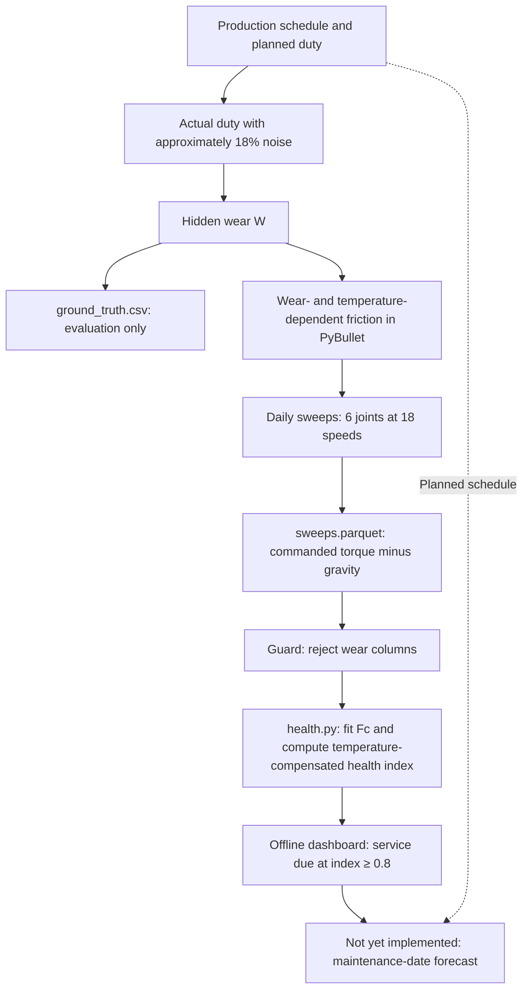

# 🤖 JointGuard AI: Predictive Maintenance for Industrial Robot Joints

**JointGuard AI is** a research project for estimating when an industrial robot joint will need maintenance. It relies on internal machine signals, such as friction, torque, and temperature, rather than on cameras alone. The project uses two separate data sources. The first is real data from bearing and gearbox test rigs, used to develop and evaluate the method. The second is a KUKA iiwa arm simulated in PyBullet: wear is injected manually, so every generated operating dataset comes with known ground truth for verification. The current version includes a data pipeline, RUL baselines, a simulator, a per-joint health index, and a dashboard. **There is no RUL model, no fault detector, and no maintenance-date forecast yet, and the system has not been run on a real robot.**

> Status based on the repository documentation as of October 12, 2026 (`docs/GUIDE.md`, `docs/LIMITS.md`, and `results/LOG.md`).

---

## 🎯 Problem and Objectives

A sudden robot joint failure can bring an entire production line to a halt. Fixed-schedule maintenance can be costly: healthy joints may be serviced unnecessarily, while joints that wear faster may fail before their scheduled maintenance. The project's goal is to monitor each joint using internal machine signals, then combine this information with the production schedule to estimate when maintenance will be needed.

The project separates this into three questions. Each uses a different type of data, and results from one must not be used to answer another:

| Component | Question | Data | Status |
| :--- | :--- | :--- | :--- |
| `rul/` | What fraction of this bearing's useful life remains? | XJTU-SY (development); IMS and KAIST (one-time final evaluation) | Evaluation framework and 3 baselines implemented; **no model yet** |
| `faults/` | Is anything abnormal, and what type of fault is it? | SEU, CWRU | Data readers implemented; **no classifier or anomaly detector yet** |
| `robot/` | When will this simulated robot joint need maintenance? | PyBullet-generated data only | Simulation, data, health index, and dashboard implemented; **no forecast yet** |

**The role of simulation.** There is currently no real-robot dataset that tracks joints until maintenance is required. Simulation produces data with known wear levels, allowing the entire pipeline to be checked end to end. The trade-off is that any accuracy measured in simulation holds *by construction*: the program injects wear and then recovers it using the same physics model.

**Current scope.** The project's overall claim is limited to validating the method on real bearing and gearbox data and demonstrating an end-to-end pipeline on a simulated robot joint. The project has not been validated on a real robot. Bearing and gearbox data is **not** robot telemetry.

---

## ✨ Key Features

Legend: ✅ implemented · 🧪 implemented but disabled or used only in experiments · ⏳ not yet implemented

| Feature | Description | Status |
| :--- | :--- | :--- |
| Readers for 5 datasets | XJTU-SY, IMS, KAIST, SEU, and CWRU mapped to a common `Recording` type. Only one snapshot is read from disk at a time | ✅ |
| Vibration features | 10 features per sensor (`rms`, peak, kurtosis, crest, 5 frequency bands defined in Hz, and spectral centroid). Each feature is compared with the same bearing's initial healthy period | ✅ (extracted and cached for XJTU-SY only so far) |
| RUL evaluation framework | Targets the remaining-life fraction, with 2 data splits (leave-one-bearing-out and leave-one-condition-out) and 8 metrics. Tests check that no future information is used | ✅ |
| 3 RUL baselines | Constant 0.5, elapsed-time-based, and an `rms` lookup table | ✅ |
| RUL model | Must outperform the baselines under predefined acceptance criteria | ⏳ |
| Fault classification and anomaly detection (SEU, CWRU) | Only data readers and tests are available | ⏳ |
| Final evaluation on IMS and KAIST | To be run exactly once, after the model is frozen | ⏳ |
| KUKA iiwa simulation in PyBullet | Stribeck and viscous friction, workload-dependent wear, and joint temperature | ✅ |
| Health-check sweep | Rotate one joint at 18 constant speeds, subtract gravity, then fit Coulomb and viscous friction | ✅ |
| Daily loop and production schedule | 2 load scenarios, each with 5 robots with different wear rates, swept daily | ✅ |
| Ground-truth separation and leakage prevention | Hidden wear is stored only in `ground_truth.csv`. A guard rejects sweep files containing a wear column | ✅ |
| Per-joint health index | Compare current Coulomb friction with the same joint's first week, with temperature compensation | ✅ (uses simulation coefficients; see Limitations) |
| 5 realism switches | Wear noise, late-life wear acceleration, wear-induced viscous friction growth, model mass error, and sensor faults | 🧪 implemented and evaluated, **disabled by default** |
| Maintenance events (regreasing) | Reduce joint wear and record the event in `events.csv` | 🧪 code and tests exist, but no scenario includes them yet |
| Visual demo | Open a PyBullet window, sweep one joint at a wear level specified on the command line, and print its health index | ✅ (one sweep only; no slider) |
| HTML dashboard | One self-contained HTML file per scenario, available offline, with robot/joint/day filters and a ground-truth toggle | ✅ |
| Dashboard “service due” flag | Threshold rule: activates when the health index reaches 0.8. This is not a forecast | ✅ |
| Production-schedule-based maintenance-date forecast | Regress wear rate against workload, then integrate over the planned schedule | ⏳ (only a temporary reference estimator exists in an experimental script) |
| Real-time alerts and deployment on a real robot | — | ⏳ outside the current scope |

---

## 🚀 Installation and Usage

**Environment.** Conda, Python 3.10. Dependencies include numpy, scipy, pandas, scikit-learn, matplotlib-base, pybullet, pyarrow, and pytest. This environment does not use PyTorch, PyQt, or a web framework.

```bash
conda env create -f environment.yml
conda activate pdm
python -m pytest tests -q          # Synthetic data only; no dataset downloads required
```

### Robot Simulation (No External Data Required)

```bash
# Visual demo: sweep joint 3 at wear level 0.5 in a PyBullet window and print its health index
python -m tools.robot demo --gui --joint 3 --wear 0.5

# Generate data: 5 robots, 850 days each, saved to data/simulation/ramp_early/run_<k>/
python -m tools.robot demo --scenario ramp_early --days 850 --seed 0 --runs 5
python -m tools.robot demo --scenario ramp_late  --days 1450 --seed 0 --runs 5

# HTML dashboard, saved to results/robot/dashboard_<scenario>.html
python -m tools.dashboard --scenario ramp_early
python -m tools.dashboard --scenario ramp_late --no-truth   # Exclude ground truth entirely from the file
```

Open a specific dashboard view using URL parameters, for example:
`dashboard_ramp_early.html?run=2&joint=4&day=600&truth=1&theme=dark`.

### Bearing Analysis (Raw Data Required)

Place the raw data in `data/external/`, following the directory structure described in `docs/DATASETS.md`. Raw datasets are not included in the repository.

```bash
python -m tools.sources            # List what each reader finds on disk
python -m tools.features xjtu      # Extract and cache features in data/processed/ (--force to rebuild)
python -m tools.rul evaluate       # Evaluate the 3 baselines on XJTU-SY
```

### Recorded Runtimes

The following measurements were taken on the author's Mac and are provided for reference only:

| Task | Runtime |
| :--- | :--- |
| Test suite | Approximately 17 s |
| `tools.sources` | Approximately 8 s |
| XJTU-SY feature extraction (9,216 snapshots) | 69 s |
| `tools.rul evaluate` | Under 1 s |
| One simulated day (6 joint sweeps) | 0.32 s wall-clock time |
| 10 runs across both scenarios | 63 minutes wall-clock time |
| One GUI demo sweep | Approximately 29 s (played at one-fifth real-time speed) |

> `legacy/robot_simulator_8/` is the PyQt simulator from an earlier project, retained for reference only. It requires a separate environment (see `legacy/README.md`), is not imported by this project, and its results are not results of this project.

---

## ⚙️ Simulation and Data Pipeline

### Robot and Control

- **Robot:** `kuka_iiwa/model.urdf` from `pybullet_data`, with a fixed base. Sweeps use 6 joints (0 through 5). Experiments run in `DIRECT` mode without a window; the GUI is used only for the demo.
- **Time step:** 1/1000 s during sweeps.
- **Joint under test:** Disable PyBullet's default velocity motor (`VELOCITY_CONTROL`, `force=0`), then use `TORQUE_CONTROL` with a proportional (P) velocity controller. The gain is scaled by the joint inertia, taken from the diagonal of the mass matrix.
- **Other joints:** Held by PyBullet position motors, acting like joint-holding brakes. When held using PD torque computed in Python, as specified in the original design, these joints drifted to PyBullet's velocity limit (`docs/GUIDE.md`, Section 6).
- **Built-in URDF damping is set to 0.** Leaving it enabled caused a 4,419% error in the measured viscous friction of one wrist joint.

### Degradation Model (Hidden State)

- **Friction:** Stribeck plus viscous friction. `tanh(v/eps)` replaces `sign(v)` to avoid an abrupt sign change near `v = 0`. Friction magnitudes are scaled to each joint's inertia because joint inertias differ by approximately a factor of 4,000.
- **Wear:** `dW/dt = k·u(t)`, where `u` is the *actual* workload (duty). Coulomb friction increases with `W`. Each robot has its own wear-rate coefficient, with approximately 15% variation between robots.
- **Temperature:** A one-line model. Each day, joint temperature moves 0.7 of the way toward `26 °C + 15 °C × duty`. Hotter joints have lower friction, by approximately 0.8% per degree.
- **Production schedule:** A fixed template combining load level × weekly pattern × busy and quiet periods. Actual duty equals planned duty multiplied by noise of approximately 18%, with a mean of 1.
- **Two scenarios:** `ramp_early` doubles the load from day 200, before any joint requires maintenance. `ramp_late` doubles the load from day 1500, beyond the duration of the current runs.

### Health-Check Sweep

Each day, each joint is swept at 18 constant speeds: 9 in each direction, starting at 0.10 times its rated speed. At each speed, the joint is held for 0.1 s to settle and another 0.1 s for measurement.

| Quantity | Source |
| :--- | :--- |
| Joint angle and velocity | Read directly from PyBullet |
| Commanded torque | Set by the velocity controller (`TORQUE_CONTROL`) |
| Gravity torque | Computed using `calculateInverseDynamics(q, 0, 0)` |
| **Friction torque** | **Computed:** commanded torque − gravity torque, plus Gaussian sensor noise (1.1% of Coulomb friction) |
| Fc (Coulomb), Fv (viscous) | Computed by fitting `τ = Fc·sign(v) + Fv·v`, using only points where the absolute velocity is ≥ 0.08 times the rated speed |
| Joint temperature | From the assumed thermal model above |
| Planned duty | From the production schedule. This is the only duty value included in the sweep data file |
| Wear level W | **Hidden**, written only to `ground_truth.csv` |

The robot component does not use acceleration, power, contact forces, or vibration signals.

### Processing Flow



The simulation runs in `DIRECT` mode with `dt = 1 ms`. Health-index calculations do not look ahead. The sweep data is accompanied by `schedule.csv`, `actual_duty.csv`, and `events.csv`; ground truth is kept separate and must not be read by the model.

Each `data/simulation/<scenario>/run_<k>/` directory contains these 5 files:

| File | Contents |
| :--- | :--- |
| `sweeps.parquet` | One row per (day, joint, speed). This is the model input dataset and contains no wear levels |
| `schedule.csv` | Planned duty for each day |
| `actual_duty.csv` | Actual duty. Whether the model may read this file is **still undecided** |
| `events.csv` | Maintenance log (empty in both scenarios) |
| `ground_truth.csv` | Hidden wear and the true maintenance-due date for each joint. This is the ground truth |

---

## 🧠 Algorithms and Machine Learning

**No machine learning model has been trained in this project yet.** The current components use simple statistical and physical calculations, described below:

| Component | Method | Output |
| :--- | :--- | :--- |
| Relative features (`features/`) | Divide each feature by the median of the same bearing's first 10 snapshots. The reference period is defined by snapshot count, not percentage of lifespan, because total lifespan is unknown at prediction time | 10 ratios per snapshot. With multiple sensors, retain the sensor showing the largest change |
| Constant baseline | Always predict `s = 0.5` | Reference for an uninformed prediction (MAE 0.25) |
| Time baseline | `s = 1 − elapsed hours / median lifespan of training bearings` | Reference for a prediction based only on elapsed time |
| RMS-only baseline | A lookup table with 10 bins of relative `rms`, built from the training bearings. Each bin returns the median `s` and a 90% interval | `s` and a 90% interval. This is a statistical lookup table, not a deep learning model |
| Friction fit (`robot/fit.py`) | Two-parameter linear regression | Fc, Fv |
| Health index (`robot/health.py`) | `(Fc / first-week Fc − 1) / 1.5`, with temperature compensation. Each day's calculation uses only that day and the first week | One value per joint per day. By design, this approximates wear level W |
| “Service due” flag | Threshold rule: index ≥ 0.8 | Yes or no. **Not a forecast**, and not RUL |

**Evaluation principles already implemented:**

- Split data by whole bearings, not by windows or snapshots.
- Every prediction at time `t` uses only data available up to `t`. The test `test_streaming_predictions_equal_batch_predictions` checks this. When look-ahead was deliberately introduced into two baselines, the test failed in both cases.
- Every results table must include all 3 baselines.

**Plans for components not yet implemented** (from `CLAUDE.md`; these are not current features):

- **RUL:** A model using relative features. It will be accepted only if leave-one-bearing-out MAE improves significantly (the paired-bootstrap 95% confidence interval excludes 0), leave-one-condition-out MAE does not worsen by more than 0.005, and near-failure recall does not decrease.
- **Faults and anomalies:** A detector trained only on healthy windows, separately for each condition. An alert requires 2 consecutive flagged windows. Reports must include the false-alarm rate, detection rate, and detection delay.
- **Robot forecasting:** Regress the wear rate `k` against cumulative duty, integrate over the planned schedule, and identify the first day the threshold is exceeded. This method uses only numpy and a closed-form solution, without neural networks. Compare it with constant-rate and linear-extrapolation baselines, and measure sensitivity to ±30% deviations from the plan.

---

## 📊 Results and Testing

### 1. RUL Baselines on XJTU-SY (Real Bearing Data, 15 Bearings)

MAE measures error in the remaining-life fraction `s` (from 0 to 1). An always-0.5 prediction has an MAE of 0.25.

| Predictor | MAE (leave-one-bearing-out) | MAE (leave-one-condition-out) | Bearings with MAE < 0.25 | Near-failure recall | 90% interval coverage |
| :--- | :--- | :--- | :--- | :--- | :--- |
| Constant 0.5 | 0.252 | 0.252 | 0/15 | 0.00 | 0.90 |
| Time-based | 0.317 | 0.329 | 3/15 and 2/15 | 0.47 and 0.53 | 0.87 and 0.74 |
| RMS-only | **0.200** | **0.203** | 10/15 | 0.37 and 0.43 | 0.86 and 0.83 |

**Interpretation.** RMS-only is the strongest baseline, but it is still weak: it improves on the uninformed prediction by only 21% and performs worse than that reference on 5/15 bearings (4 of them at 40 Hz). Near-failure recall can be inflated by predicting failure far too early, so it must always be read alongside MAE. The baseline's nominal 90% interval achieves only 0.83–0.86 coverage, falling short of its stated 90%. This is the reference that a future RUL model must beat. **These results concern bearings, not robots.**

### 2. Robot Simulation: Verification Milestones

All numbers in this section come from simulation. The program injects wear and recovers it using the same code, so the results demonstrate computational consistency, **not accuracy on a real robot.**

| Milestone | Question | Result |
| :--- | :--- | :--- |
| M1: one sweep | Can the sweep recover the injected friction? | Fc matches the injected value within approximately 0.7% on 6/6 joints (with noise). At W = 0.8, the health index ranges from 0.798 to 0.812 |
| M2: daily loop | Does the same seed produce identical files? Is ground truth kept separate? | All 5 files are byte-for-byte identical. The guard works correctly. After temperature compensation, the index tracks hidden wear within approximately 0.003; without compensation, the deviation reaches 0.063 |
| M3: multiple robots | Does every joint reach the threshold? Does wear in one joint affect another? | 30/30 joint trajectories reach the threshold in each scenario. When only joint 3 wears, its Fc increases by +113.7%, while the other joints change within ±0.53% |
| M4: realism switches | How does each switch affect a straight-line forecast? | Only late-life wear acceleration has a substantial effect: forecasts are **late** for 30/30 joints, by 11 days on average and 28 days in the worst case. The other switches change the error by less than 1 day |
| M5: visual demo | Does the window open, and does the printed index match the specified wear? | The window opens and prints 0.51 for W = 0.5. Across 6 joints × 5 wear levels, the maximum deviation is 0.021 |
| Dashboard | Does the page work, and is the “service due” flag correct? | The page loads and renders in headless Chrome, and all controls respond. The flag activates **after** the true maintenance-due date, by 4.0 days on average for `ramp_early` and 7.5 days for `ramp_late` |

The current dataset covers 2 scenarios × 5 robots × 6 joints, running for 850 and 1,450 days, totaling 1,242,000 sweep rows and approximately 25 MB. The maintenance-due date for the same joint differs by as much as 509 days between robots, so it cannot be inferred from joint ID alone.

The 11-day figure in M4 is the error of a temporary reference estimator written in an experimental script. It also uses the simulation's true temperature coefficient. It is not a result from the project's forecasting component, which has not yet been implemented.

### 3. Testing

- The test suite uses synthetic data only: 206 tests, approximately 17 s (`docs/GUIDE.md`, Section 11).
- Each new component is checked by deliberately inserting bugs into the code, one at a time, to see whether the tests catch them. Examples include calculating gravity at the wrong angle, using `sign` instead of `tanh`, writing actual duty into the sweep file, or assigning the same wear coefficient to all 6 joints. The current tests catch every injected bug tried so far (20, 28, 12, 26, 11, and 20 bugs at the respective milestones).
- Final evaluation on IMS and KAIST has not been run.
- Fault classification and anomaly detection have no quantitative results yet.

---

## 🏗️ Architecture

```text
robot-pdm/
├── CLAUDE.md                 # Project rules: scope, evaluation criteria, commands
├── config.py                 # All bearing-analysis parameters, with rationale
├── environment.yml           # Conda environment "pdm"
├── sources/                  # One reader per dataset → Recording
│   ├── recording.py          # Shared data type; lazy snapshot loading from disk
│   ├── xjtu.py  ims.py  kaist.py  seu_cwru.py
├── features/                 # Snapshot features, relative features, cache
├── rul/                      # Data, 3 baselines, metrics, evaluation with 2 split strategies
├── robot/                    # PyBullet simulation; separate parameters in robot/config.py
│   ├── world.py              # Load KUKA iiwa, disable default motors, lock holding joints
│   ├── friction.py           # Wear- and temperature-dependent Stribeck + viscous friction
│   ├── sweep.py  fit.py      # 18-speed sweep and Fc/Fv regression
│   ├── schedule.py           # Production schedule and 2 scenarios
│   ├── thermal.py            # One-line thermal model
│   ├── simulate.py           # Daily loop, multiple runs, realism switches
│   ├── collect.py            # Write the 5 data files for each run
│   ├── guard.py              # Reject sweep files containing wear levels
│   ├── health.py             # Health index from saved sweeps
│   └── checks.py  view.py    # Helpers for verification and GUI demo
├── tools/                    # CLI entry points: sources, features, rul, robot, dashboard
│   └── dashboard_template.html
├── tests/                    # 26 test files; synthetic data only
├── results/                  # One directory per experiment: script, raw output, conclusions
│   │                         # LOG.md serves as the index
│   └── robot/                # HTML dashboards, sweep/lifecycle/demo images
├── docs/
│   ├── GUIDE.md              # Experiments: observations, hypotheses, measurements, conclusions
│   ├── LIMITS.md             # All weaknesses, unverified claims, and simulation-only results
│   ├── DATASETS.md           # Sources, citations, licenses
│   └── CODE_GUIDE.md         # Step-by-step explanations of every function for reimplementation
├── data/
│   ├── external/             # Raw data: gitignored, not committed
│   ├── processed/            # Cached features: gitignored pending license checks
│   └── simulation/           # Simulated robot datasets
└── legacy/robot_simulator_8/  # Archived PyQt simulator from the previous project
```

The project does not currently contain a `faults/` directory or the commands `tools.faults` and `tools.final_test`. These components have not yet been implemented.

---

## ⚠️ Limitations

The complete list is in `docs/LIMITS.md`. Key points:

**The gap between simulation and real robots**

- Friction parameters, rated speeds, poses, and noise levels are *chosen*, not *measured* on a real robot.
- Gravity is subtracted using the same model as the simulation, so it cancels almost perfectly (an error of approximately 0.000007 N·m). A real robot's dynamics model would never be this accurate.
- Holding joints are rigidly locked, so the test showing that wear in one joint does not affect another passes by construction.
- Sensor noise is very simple: torque-only, Gaussian, without outliers or drift unless the sensor-fault switch is enabled.
- The health index uses the wear-amplification and temperature coefficients *from the simulation itself*. A real system would have to estimate both. Without temperature compensation, the index deviates by up to 0.06, equivalent to 8% of the maintenance threshold.

**The simulated data is overly clean**

- In the current dataset, wear is exactly proportional to workload and sensors never fail. All 5 realism switches are disabled.
- Late-life wear acceleration makes a straight-line forecast late for every joint. With that switch disabled, this weakness is not visible in the data.
- There are only 5 robots, not 10. Run `k` in both scenarios uses the same seed, so the data is identical through day 199. The 6 joints in a run also share the same work schedule.
- No joints are serviced during the runs, so wear continues to increase after maintenance becomes due, reaching 3.7. Data rows after the maintenance-due date should not be used.
- The production schedule follows a periodic template, whereas real plans do not repeat so neatly.

**Bearing analysis**

- There is no model yet. The best baseline remains weak, and its nominal 90% interval does not achieve 90% coverage.
- XJTU-SY contains only 15 bearings. Their lifespans vary by a factor of 60 (0.68 to 42.3 hours).
- IMS has only 3 independent runs, and KAIST has only 1 bearing. The failure date in IMS test 3 remains uncertain. The author has previously seen results on IMS and KAIST in an earlier project, so these datasets are no longer completely untouched holdouts.
- CWRU records normal files at 48 kHz and fault files at 12 kHz. A classifier could distinguish normal from faulty data based on recording differences rather than bearing condition.
- Only the KAIST license has been checked (CC BY 4.0). Features or models derived from the other datasets have therefore not been committed.

**Dashboard and demo**

- The dashboard shows a joint's *current condition*, not *when* maintenance will be required. The “service due” flag activates several days after the true maintenance-due date.
- The dashboard has only been tested by scripts in Chrome at a width of 1280 px, with no real users. Safari, Firefox, mobile devices, and touchscreens have not been tested.
- The demo performs one sweep, with no slider and no forecast.

---

## 🗺️ Roadmap

The following items are plans, **not current features**. Deadlines are the milestones set in `CLAUDE.md`.

| Deadline | Planned Work |
| :--- | :--- |
| October 20, 2026 | Compare the RUL model with all 3 baselines and accept or reject it under the predefined criteria. Implement fault classification and anomaly detection on SEU/CWRU with rigorous data splits. Freeze the RUL model |
| October 27, 2026 | Forecast robot maintenance dates: compare with constant-rate and linear-extrapolation baselines in both scenarios, and measure sensitivity to ±30% deviations from the plan. Run final evaluation on IMS and KAIST exactly once |
| November 1, 2026 | Finalize README, GUIDE, and LIMITS; record the demo video; submit the project |

Other decisions requiring user input:

- Which of the 5 realism switches to enable. `WEAR_ACCEL` makes the forecasting problem more challenging and its evaluation more honest.
- Whether the model may read `actual_duty.csv`.
- Whether to add maintenance events to the scenarios.
- Collecting data and testing on a real single-arm robot in a factory. This is currently outside the scope.

---

## 🤖 AI-Assisted Development

The project was built with **Claude Code** (Anthropic). The repository documents the following workflow:

- **Decisions made by the author.** `CLAUDE.md` defines the scope, evaluation rules, technical constraints, plan, and actions that require the author's approval: adding dependencies, deleting files, committing changes, and enabling switches. The robot component follows the specifications in `sim.md` and `ROBOT_SIM_DATA_SPEC.md`. For example, the dashboard was built at the author's request on October 12, and the old 400-day runs were deleted at the author's request.
- **Claude Code's role.** Claude Code works within those rules. `docs/GUIDE.md` is written in the first person and records each experiment: expectations stated before execution, measurements, cases where expectations were wrong, and decisions to retain or reject an approach.
- **Quality control.** Each experiment's script and raw output are stored in `results/`. New code is checked by deliberately inserting bugs to challenge the tests. All weaknesses are recorded in `docs/LIMITS.md`. `docs/CODE_GUIDE.md` explains every function step by step so the author can reimplement and explain it independently.

To explore the simulation component, start with `docs/GUIDE.md` (Sections 6–11) and the corresponding directories in `results/`.

---

## 📚 Data and Citations

The project uses the public XJTU-SY, IMS (NASA), KAIST, SEU, and CWRU datasets. Sources, citation instructions, and license status for each are documented in `docs/DATASETS.md`. Raw datasets are not included in the repository.
